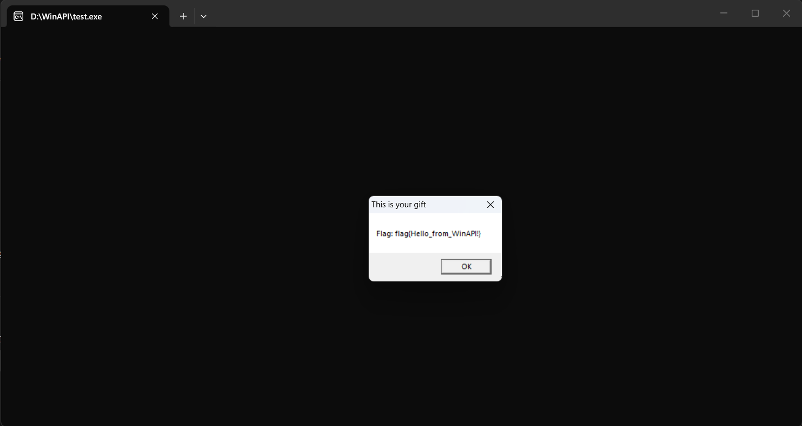

# WinAPI

WinAPI (hay được biết đến là Win32; tên gọi chính thức là Microsoft Windows API) là một giao diện lập trình ứng dụng được viết bằng ngôn ngữ lập trình C/C++ bởi Microsoft để cho phép các chương trình hoặc ứng dụng truy cập vào các chức năng của Windows, hoặc ngoài ra nó còn được sử dụng để tạo nên các ứng dụng trên Windows. 

Windows API có thể được chia ra thành một số lĩnh vực như: 
- Base services: Cung cấp các quyền để truy cập vào các tài nguyên cơ bản trên Windows, nó có thể bao gồm các file systems, devices, processes, threads, registry hoặc error handling.
- Security: Cung cấp các functions, interfaces, objects và các thành phần lập trình khác cho việc xác thực, ủy quyền, mật mã hoặc các vấn đề liên quan đến bảo mật khác.
- Graphics: Cung cấp chức năng xuất nội dung đồ họa ra màn hình, máy in và các thiết bị đầu ra khác.
- User interface: Cung cấp chức năng tạo cửa sổ và điều khiển.
- Multimedia: Cung cấp các công cụ để làm việc với video, âm thanh và các thiết bị đầu vào.
- Windows shell: Cho phép các ứng dụng truy cập vào các hàm được cung cấp bởi shell của hệ điều hành.
- Networking: Cung cấp các quyền truy cập vào các khả năng mạng của HĐH Windows.

Ví dụ cho đoạn mã C như sau:

```c
#include <windows.h>

int main() {
    MessageBoxA(
        NULL,
        "Flag: flag{Hello_from_WinAPI!}",
        "This is your gift",
        MB_OK
    );

    return 0;
}
```

Đoạn mã C này sử dụng thư viện `windows.h` để khai báo các API của Windows, từ đó có thể gọi các hàm do Windows cung cấp. Cái `windows.h` này nó là một header file của Windows SDK, nó chứa các khai báo, kiểu dữ liệu, macro, hằng số,... cần thiết để sử dụng được WinAPI. Hàm `MessageBoxA()` ở trên cũng là được khai báo thông qua các header của Windows. Tương tự với cái `MB_OK` cũng là một hằng/macro được Windows định nghĩa.

Điểm đáng chú ý ở đây là `windows.h` không chứa toàn bộ code của hàm `MessageBoxA()`. Tức là nó sẽ không lấy toàn bộ source code của hàm `MessageBoxA()` từ `windows.h`. Thực chất, WinAPI là các file `.dll` (viết tắt của Dynamic-Link Library) hệ thống nạp sẵn như: `kernel32.dll`, `user32.dll`, `advapi32.dll`, `ntdll.dll`,... Các hàm như `MessageBoxA()` được viết trong các file `.dll` này (cụ thể là ở trong `User32.dll`). Khi dùng  `#include <windows.h>` thì nó sẽ khai báo đến các hàm như `MessageBoxA()` này và khi sử dụng các hàm như thế thì chương trình sẽ gọi đến file `.dll` chứa source code của các hàm đó (cụ thể là gọi đến file `user32.dll` đang chứa source code của `MessageBoxA()`) để thực thi. Kết quả trả về sẽ là việc Windows hiển thị một cái MessageBox mà ta đã sử dụng trong chương trình.

Compile code trên bằng lệnh:
```bash
gcc test.c -o test
```

sẽ cho ta một file `test.exe`. Khi chạy file `.exe` này, ta sẽ nhận được thông báo là:



Ngoài lề thì ta có syntax của hàm `MessageBoxA()` như sau:

```c
int MessageBoxA(
  [in, optional] HWND   hWnd,
  [in, optional] LPCSTR lpText,
  [in, optional] LPCSTR lpCaption,
  [in]           UINT   uType
);
```

Chúng ta chưa cần hiểu về nó ngay, sau này tìm hiểu sau cũng được:)

Nói sơ qua một chút thì WinAPI là một thực thể động. Số lượng các chức năng liên tục tăng lên theo từng phiên bản mới của hệ điều hành Windows và các gói dịch vụ mới. Ngoài ra còn có một số khác biệt quan trọng giữa phiên bản máy chủ và phiên bản máy tính để bàn của hệ điều hành. Một số chức năng không được ghi lại chính thức.


# Các hàm chính của WinAPI

Ta đã biết thì hàm `int main()` là entry point (điểm đầu vào) của một chương trình C hay C++, hiểu theo nghĩa trong giới lập trình là nơi mà code bắt đầu chạy. Nhưng cũng cần phải hiểu rõ đây không phải là hàm đầu tiên được chạy trong chương trình. Khi entry point là hàm `main` thì quá trình thực thi chương trình thực ra sẽ bắt đầu tại hàm có tên là `mainCRTStartup`. Hàm này sẽ nằm trong thư viện C Runtime (CRT). Nó sẽ khởi tạo các thành phần như memory manager, hỗ trợ file I/O và tham số argv. Sau đó `mainCRTStartup` mới gọi đến hàm `main`.

Về căn bản thì ta có thể hiểu nó như này: Ở mức source code C thì các lập trình sẽ xem hàm `main` như là điểm bắt đầu chương trình. Ví dụ như này:
```c
#include <stdio.h>
int main()
{
    printf("Hello World!");
    return 0;
}
```
Khi mà mới học C thì người ta thường nói chương trình sẽ bắt đầu từ hàm `main`. Điều này là đúng với góc nhìn của người học ngôn ngữ C. Nhưng mà đối với hệ điều hành, cụ thể ở đây là Windows thì không nghĩ như vậy.